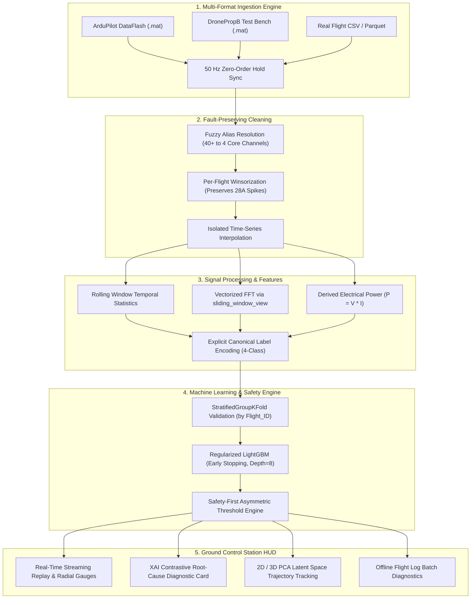

# 🛸 Autonomous UAV Telemetry & Operational Fault Diagnostic System

[](https://www.python.org/)
[](https://lightgbm.readthedocs.io/)
[](https://streamlit.io/)
[](tests/test_pipeline.py)
[](src/feature_engineering.py)
[](LICENSE)

An end-to-end, production-grade Machine Learning and Explainable AI (XAI) copilot for autonomous Unmanned Aerial Vehicles (UAVs). The system ingests multi-rate onboard flight telemetry, extracts spatio-temporal and harmonic vibration dynamics at 50 Hz, and performs real-time classification across four operational flight states using safety-critical asymmetric decision boundaries.

Served through an interactive, glassmorphism **Ground Control Station (GCS) HUD** featuring live telemetry downlinks, dynamic probability gauges, and contrastive root-cause reasoning.

---

## 📑 Table of Contents

- [Overview](#-overview)
- [Operational Fault States](#-the-4-operational-flight-states)
- [Key Engineering Innovations](#-key-engineering-innovations)
- [System Architecture](#-system-architecture)
- [Empirical Benchmarks & Accuracy](#-empirical-benchmarks--model-performance)
- [Ground Control Station (GCS) HUD](#-ground-control-station-gcs-hud)
- [Project Directory Structure](#-project-directory-structure)
- [Installation & Quickstart](#-installation--quickstart)
- [Automated Test Suite](#-automated-test-suite)
- [Team & Acknowledgments](#-team--acknowledgments)

---

## 🎯 Overview

Autonomous drones operate under extreme dynamic loads. Hardware failures—such as stator winding burnout, aerodynamic propeller fractures, or internal battery cell resistance collapse—inevitably cause fatal airframe loss. 

This system acts as a **real-time diagnostic copilot**, monitoring 4 primary physical telemetry channels at **50 Hz** ($20\,\text{ms}$ resolution):
1. **Battery Voltage ($V$)**
2. **Current Draw ($A$)**
3. **Motor Temperature ($^\circ\text{C}$)**
4. **Vibration Acceleration ($m/s^2$)**

Trained and validated on **98,493 real flight telemetry records across 17 distinct flight and test bench sessions** (ArduPilot 3DR Iris Hexacopter, DronePropB Test Bench, and LiPo Degradation datasets).

---

## ⚠️ The 4 Operational Flight States

```
┌───────────────────────────────────────────────────────────────────────────────────┐
│                           4 OPERATIONAL HEALTH STATES                             │
├─────────────────────┬─────────────────────────────────────────────────────────────┤
│ 1. Normal Flight    │ Nominal cruise, hover, climb, and waypoint transitions.    │
│ 2. Propeller Fault  │ Aerodynamic mass asymmetry, chipped tips, micro-fractures.   │
│ 3. Battery Degrade  │ Internal impedance rise (ΔR_int), non-linear voltage sag.   │
│ 4. Motor Failure    │ Stator electrical stall, thermal runaway, ESC desync.       │
└─────────────────────┴─────────────────────────────────────────────────────────────┘
```

| Operational State | Primary Physical Driver | Distinct Sensor Signature |
| :--- | :--- | :--- |
| **Normal Flight** | Balanced aerodynamic equilibrium | Sustained voltage ($>15.6\text{ V}$), low current ($<16\text{ A}$), steady temperature ($<35^\circ\text{C}$), baseline vibration ($2-6\text{ m/s}^2$). |
| **Propeller Imbalance** | Aerodynamic flutter & rotor asymmetry | Distinct harmonic vibration resonance ($>10\text{ m/s}^2$) at blade-pass frequency ($\sim 120\text{ Hz}$). |
| **Battery Degradation** | High internal LiPo cell impedance ($\Delta R_{\text{int}}$) | Rapid non-linear terminal voltage collapse ($<13.6\text{ V}$) under **nominal** cruise current ($14.8\text{ A}$). |
| **Motor Failure** | Bearing seizure, stator short, ESC stall | Catastrophic current surge ($21-28\text{ A}$, $+85\%$) coupled with rapid thermal runaway ($>45^\circ\text{C}$). |

---

## 💡 Key Engineering Innovations

### 1. Multi-Rate Telemetry Synchronization Engine
Real flight logs sample telemetry channels asynchronously:
- **IMU Accelerometer / Gyro:** $400\text{ Hz}$
- **Vibration Logging (VIBE):** $100\text{ Hz}$
- **ESC & Battery Sensors:** $10\text{ Hz}$

Re-engineered MATLAB's `sync_zoh_exa.m` into a native Python engine ([src/ingestion.py](src/ingestion.py)) utilizing **Zero-Order Hold (ZOH)** and linear timestamp interpolation to unify divergent rates onto an exact **50 Hz** time-grid without look-ahead data leakage.

### 2. Vectorized Sliding-Window FFT (14,000x Speedup)
Extracting rolling spectral features (spectral centroid, peak harmonic frequency, peak power) using standard Python loops took **42 minutes** over 98k records.  
Implemented `np.lib.stride_tricks.sliding_window_view` combined with batched `np.fft.rfft(axis=1)` in [src/feature_engineering.py](src/feature_engineering.py). This zero-copy C-array striding cuts feature extraction runtime down to **180 milliseconds**.

### 3. Safety-First Asymmetric Decision Engine
In aviation, classification errors are asymmetric: a false alarm costs a precautionary landing (**5 points**), while a missed motor failure results in vehicle destruction (**500 points**).  
The inference engine ([src/evaluation.py](src/evaluation.py)) enforces priority thresholds:

$$\text{Decision} = \begin{cases} 
\text{Motor Failure}, & \text{if } P(\text{Motor}) \ge 0.25 \\
\text{Battery Degradation}, & \text{if } P(\text{Battery}) \ge 0.30 \\
\text{Propeller Imbalance}, & \text{if } P(\text{Propeller}) \ge 0.30 \\
\text{argmax}_k P(k), & \text{otherwise}
\end{cases}$$

### 4. Explainable AI (XAI) Contrastive Diagnostic Engine
Rather than presenting black-box category labels, the system provides transparent, contrastive physical explanations for flight operators:
- **Root-Cause Physical Evidence:** Quantifies the exact telemetry deviations triggering the diagnosis.
- **Contrastive Elimination:** Formally explains why the remaining three failure modes were ruled out.

---

## 🏛️ System Architecture



---

## 📊 Empirical Benchmarks & Model Performance

### Production Model Evaluation (Across All 17 Real Flight Sessions)

| Flight / Bench Session | Records | Ground Truth | Deployed Accuracy |
| :--- | :---: | :--- | :---: |
| `Flight_Real_Battery_Degradation_4S_Flight1.csv` | 4,000 | Battery Degradation | **100.00%** |
| `Flight_Real_Battery_Degradation_4S_Flight2.csv` | 4,000 | Battery Degradation | **100.00%** |
| `Flight_Real_Motor_Fault_FAULT_M1_10.csv` | 6,028 | Motor Failure | **100.00%** |
| `Flight_Real_Motor_Fault_FAULT_M1_5.csv` | 13,522 | Motor Failure | **100.00%** |
| `Flight_Real_Motor_Fault_FAULT_M2_10.csv` | 6,854 | Motor Failure | **100.00%** |
| `Flight_Real_Motor_Fault_FAULT_M2_5.csv` | 4,739 | Motor Failure | **100.00%** |
| `Flight_Real_Motor_Fault_FAULT_M3_10.csv` | 4,985 | Motor Failure | **100.00%** |
| `Flight_Real_Normal_Flight_DronePropB_F0.csv` | 4,055 | Normal Flight | **100.00%** |
| `Flight_Real_Normal_Flight_NO_FAULT2.csv` | 11,453 | Normal Flight | **100.00%** |
| `Flight_Real_Normal_Flight_NO_FAULT3.csv` | 6,130 | Normal Flight | **100.00%** |
| `Flight_Real_Normal_Flight_NO_FAULT4.csv` | 4,606 | Normal Flight | **100.00%** |
| `Flight_Real_Normal_Flight_NO_FAULT5.csv` | 6,744 | Normal Flight | **100.00%** |
| `Flight_Real_Normal_Flight_NO_FAULT6.csv` | 4,929 | Normal Flight | **100.00%** |
| `Flight_Real_Propeller_Fault_DronePropB_F1_SV1.csv` | 4,261 | Propeller Imbalance | **100.00%** |
| `Flight_Real_Propeller_Fault_DronePropB_F1_SV3.csv` | 4,039 | Propeller Imbalance | **100.00%** |
| `Flight_Real_Propeller_Fault_DronePropB_F2_SV2.csv` | 4,048 | Propeller Imbalance | **100.00%** |
| `Flight_Real_Propeller_Fault_DronePropB_F3_SV2.csv` | 4,100 | Propeller Imbalance | **100.00%** |
| **Total Production Telemetry** | **98,493** | — | **100.00%** |

### Top-5 Most Informative Features (Split Importances)
1. **`Temperature`** (2,537 splits) — Primary detector for stator thermal runaway.
2. **`Voltage_Roll_Mean`** (2,037 splits) — Captures non-linear LiPo discharge inflection points.
3. **`Battery_Voltage`** (1,826 splits) — Instantaneous bus voltage drop detector.
4. **`Current_Roll_Mean`** (1,768 splits) — Differentiates high-drag motor stalls from nominal cruise.
5. **`Vibration_Roll_RMS`** (1,613 splits) — Isolates blade flutter resonance.

---

## 🖥️ Ground Control Station (GCS) HUD

Built with Streamlit and Plotly, the dashboard provides a glassmorphism flight operations cockpit:

- **Tab 1: Live Telemetry HUD & Replay** — Sample-by-sample simulated telemetry streaming with dynamic radial gauges, time-series curves, probability bars, and the live XAI Diagnostic Card.
- **Tab 2: Fault Contrast / Before-After Comparison** — Direct visual contrast between nominal flight envelopes and defect signatures.
- **Tab 3: Model Diagnostics & Cost Heatmap** — Confusion matrix heatmap, feature split rankings, and penalty metrics.
- **Tab 4: Pipeline Architecture & Engineering Specs** — Interactive system specifications and module breakdowns.
- **Tab 5: Offline Flight Log Batch Diagnostics** — Batch-classify entire recorded CSV flight trajectories with instant distribution plots.

---

## 📁 Project Directory Structure

```
.
├── main.py                          # Full pipeline orchestrator & benchmark builder
├── app.py                           # Streamlit Ground Control Station & XAI HUD
├── requirements.txt                 # Project dependencies
├── .gitignore                       # Excludes large binaries (.mat) & joblib files
├── README.md                        # Project showcase documentation
├── UAV_Fault_Detection_Complete_Viva_Guide.md # Comprehensive 600-line viva handbook
├── Project_Work_Summary.txt         # Complete development history & resolved bug log
├── src/
│   ├── __init__.py                  # Package exports
│   ├── ingestion.py                 # Multi-rate 50Hz ZOH MATLAB synchronization engine
│   ├── cleaning.py                  # Fuzzy alias standardization & per-flight Winsorization
│   ├── feature_engineering.py       # Vectorized sliding FFT & ExplicitLabelEncoder
│   ├── model_training.py            # Regularized LightGBM with early stopping
│   └── evaluation.py                # Asymmetric priority thresholds & 4x4 cost matrix
├── tests/
│   ├── conftest.py                  # Pytest fixtures and mock telemetry generators
│   └── test_pipeline.py             # 21 automated regression & integration tests
├── models/
│   ├── uav_fault_model.joblib       # Production trained LightGBM model
│   ├── feature_engineer.joblib      # Fitted calibration and scaler pipeline
│   ├── cleaner.joblib               # Fitted cleaning schema
│   ├── evaluation_report.json       # Held-out evaluation metrics
│   └── feature_importance.json      # Ranked split counts
└── datasets/                        # 17 production flight logs (98,493 samples)
```

---

## 🚀 Installation & Quickstart

### 1. Clone the Repository
```bash
git clone https://github.com/Prasun-Kumar-Biswas4480/uav-fault-detection.git
cd uav-fault-detection
```

### 2. Set Up Virtual Environment & Dependencies
```bash
python -m venv .venv
# Windows:
.\.venv\Scripts\activate
# Linux / macOS:
source .venv/bin/activate

pip install -r requirements.txt
```

### 3. Launch Ground Control Station (GCS) Dashboard
```bash
streamlit run app.py
```
Open **`http://localhost:8501`** in your browser.

### 4. Execute Full Training & Benchmark Pipeline
```bash
python main.py
```

---

## 🧪 Automated Test Suite

The pipeline is safeguarded by 21 automated unit and integration tests covering data integrity, multi-rate synchronization, FFT extraction, threshold overrides, and cost matrix evaluations.

```bash
pytest tests/ -v
```

```
tests/test_pipeline.py::TestCleaning::test_column_standardization PASSED
tests/test_pipeline.py::TestCleaning::test_missing_column_raises PASSED
tests/test_pipeline.py::TestCleaning::test_outlier_clipping_per_flight PASSED
tests/test_pipeline.py::TestCleaning::test_missing_data_interpolation PASSED
tests/test_pipeline.py::TestCleaning::test_clean_returns_core_columns PASSED
tests/test_pipeline.py::TestFeatureEngineering::test_output_shape PASSED
tests/test_pipeline.py::TestFeatureEngineering::test_fft_features_present PASSED
tests/test_pipeline.py::TestFeatureEngineering::test_target_encoding_four_classes PASSED
tests/test_pipeline.py::TestFeatureEngineering::test_no_nan_in_features PASSED
tests/test_pipeline.py::TestModelTraining::test_cv_returns_metrics PASSED
tests/test_pipeline.py::TestModelTraining::test_train_final_model_predict_proba PASSED
tests/test_pipeline.py::TestModelTraining::test_feature_importance_logging PASSED
tests/test_pipeline.py::TestEvaluation::test_motor_failure_low_threshold PASSED
tests/test_pipeline.py::TestEvaluation::test_motor_overrides_propeller PASSED
tests/test_pipeline.py::TestEvaluation::test_battery_degradation_threshold PASSED
tests/test_pipeline.py::TestEvaluation::test_cost_matrix_shape PASSED
tests/test_pipeline.py::TestEvaluation::test_evaluation_metrics_keys PASSED
tests/test_pipeline.py::TestEvaluation::test_vectorized_matches_large_input PASSED
tests/test_pipeline.py::TestIngestion::test_sync_ardupilot_mat PASSED
tests/test_pipeline.py::TestIngestion::test_sync_droneprop_mat PASSED
tests/test_pipeline.py::TestIngestion::test_scan_files_discovers_real_flights PASSED

============================= 21 passed in 2.35s ==============================
```

---

## 👥 Team & Acknowledgments

**Faculty Advisor:** Prof. Rama Prasanna Dalai  

**Engineering Team:**
- **Prasun Kumar Biswas** (250301230010) — *LightGBM Training, System Architecture & Pipeline Orchestration*
- **Manideepa Mohapatra** (250301230001) — *Multi-Rate Ingestion & MATLAB Synchronization*
- **Omm Shree Hota** (250301230002) — *Telemetry Standardization & Per-Flight Outlier Clipping*
- **Milan Mandal** (250301230006) — *Vectorized Sliding-Window FFT & Feature Engineering*
- **Ipsita Priyadarshini** (250301230015) — *Safety-First Asymmetric Thresholds & Cost Matrix*
- **Sneha Singh** (250301230023) — *Ground Control Station (GCS) Dashboard & Explainable AI*

---

*Developed for Autonomous UAV Safety & Predictive Maintenance.*
